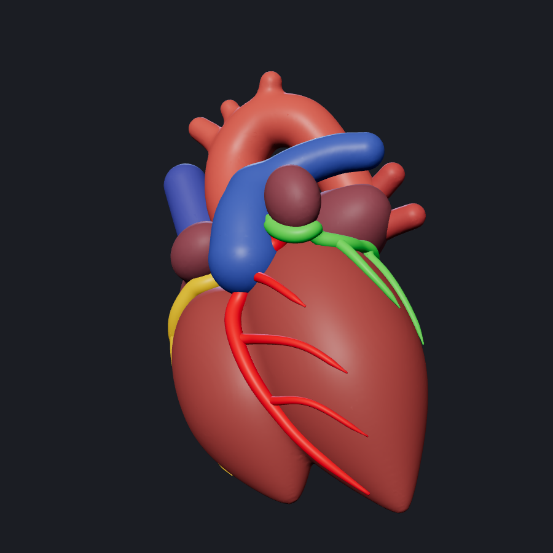

# CardioVision — Cardiovascular Risk Visualization & Prediction

**Multimodal AI Hackathon 2026 | Track A**

CardioVision is an educational research prototype that predicts overall Coronary Artery Disease (CAD) and potential stenosis in three major coronary arteries: the Left Anterior Descending (LAD), Left Circumflex (LCX), and Right Coronary Artery (RCA).

The system uses clinical, ECG, laboratory, and echocardiographic features to generate model-based predictions. These predictions are designed to support an interactive heart visualization and an explainability dashboard.

> **Medical Disclaimer:** CardioVision is intended for educational and research purposes only. Its predictions are not clinically validated and must not be used as a substitute for professional medical judgment, diagnostic imaging, or clinical evaluation.

## Table of Contents

- [Features](#features)
- [Project Status](#project-status)
- [Dataset](#dataset)
- [Model Performance](#model-performance)
- [Technology Stack](#technology-stack)
- [Prerequisites](#prerequisites)
- [Installation and Setup](#installation-and-setup)
- [Running the Project](#running-the-project)
- [API and Prediction Usage](#api-and-prediction-usage)
- [3D Heart Model](#3d-heart-model)
- [Explainability Dashboard](#explainability-dashboard)
- [Project Structure](#project-structure)
- [Testing](#testing)
- [Limitations](#limitations)
- [Future Improvements](#future-improvements)
- [Dataset Attribution](#dataset-attribution)

## Features

- **CAD Prediction:** Estimates the probability of overall coronary artery disease.
- **Artery-Specific Prediction:** Estimates the probability of stenosis for LAD, LCX, and RCA.
- **Machine Learning Comparison:** Evaluates Logistic Regression, Random Forest, and Gradient Boosting.
- **Interactive Heart Visualization:** A 3D heart in the React frontend whose LAD, LCX and RCA arteries are recoloured from the model's risk output.
- **Explainable AI:** Provides global feature importance and patient-specific SHAP explanations.
- **Patient Input Schema:** Defines accepted feature names, types, and allowed values.
- **Risk Visualization:** Maps model probabilities to LOW, MODERATE, and HIGH presentation categories.

## Project Status

| Component | Status |
|---|---|
| CAD and artery prediction pipeline | Implemented |
| Model training and evaluation | Implemented |
| Exploratory data analysis | Implemented |
| Patient input schema | Implemented |
| SHAP explainability (global and patient-specific) | Implemented (`explain.py`, `dashboard.py`) |
| 3D heart model with separate LAD / LCX / RCA nodes | Implemented (`assets/heart.glb`) |
| Prediction API | Implemented (`api_server.py`, Flask) |
| Web frontend and 3D risk view | Implemented (`frontend/heart-visualizer`), needs end-to-end testing |

Update this table as components change.

## Dataset

The project uses an extension of the **Z-Alizadeh Sani dataset**, containing 303 patients, 55 input features, and four prediction targets.

Dataset file:

`datasets/z_alizadeh_sani_extension.xlsx`

The target columns are:

- `Cath` — Overall CAD
- `LAD` — LAD stenosis
- `LCX` — LCX stenosis
- `RCA` — RCA stenosis

These target columns are excluded from model input features to prevent target leakage.

The input schema is generated in:

`docs/input_schema.json`

The patient form and API must use the exact feature names and permitted values defined in this file.

## Model Performance

The following are the reported results from repeated stratified five-fold cross-validation.

| Target | ROC-AUC | Accuracy | Precision | Recall | F1-score |
|---|---:|---:|---:|---:|---:|
| Overall CAD | 0.923 ± 0.039 | 0.863 ± 0.042 | 0.883 ± 0.034 | 0.933 ± 0.038 | 0.907 ± 0.029 |
| LAD | 0.853 ± 0.044 | 0.790 ± 0.043 | 0.790 ± 0.045 | 0.877 ± 0.056 | 0.830 ± 0.035 |
| LCX | 0.732 ± 0.063 | 0.682 ± 0.053 | 0.650 ± 0.115 | 0.440 ± 0.100 | 0.516 ± 0.093 |
| RCA | 0.721 ± 0.054 | 0.677 ± 0.037 | 0.615 ± 0.096 | 0.398 ± 0.107 | 0.475 ± 0.088 |

Random Forest was reported as the best-performing model among the three compared algorithms for all four targets.

Precision, recall, and F1-score use a classification threshold of 0.5. The LCX and RCA models have weaker performance, particularly in recall, and may miss a substantial proportion of positive cases.

Detailed results are available in:

`reports/cv_metrics.csv`

These are reported experimental results, not a guarantee of performance on new patients.

## Technology Stack

The repository's documented components include:

- **Language:** Python
- **Machine Learning:** scikit-learn
- **Model Explainability:** SHAP
- **Data Processing:** pandas and NumPy
- **Model Persistence:** joblib
- **Data Visualization:** Streamlit for the explainability dashboard
- **Testing:** pytest
- **Frontend Visualization:** React and Three.js-based tooling, if included in the current frontend implementation

Install the Python dependencies from `requirements.txt`. Frontend dependencies, if applicable, should be installed separately from the frontend directory using its package manifest.

## Prerequisites

Install the following before running the project:

- Python 3.10 or another Python version supported by the pinned project dependencies.
- pip, the Python package installer.
- Git.
- A terminal such as PowerShell, Command Prompt, or a Bash terminal.
- Node.js and npm only if running the React frontend.

Check your installations:

```bash
python --version
python -m pip --version
git --version
```

For the frontend, if present:

```bash
node --version
npm --version
```

## Installation and Setup

### 1. Clone the repository

```bash
git clone https://github.com/triiishaha/cardiovascular-project.git
cd cardiovascular-project
```

### 2. Create a virtual environment

**Windows — PowerShell:**

```powershell
python -m venv venv
.\venv\Scripts\Activate.ps1
```

If PowerShell blocks activation, use Command Prompt:

```bat
venv\Scripts\activate.bat
```

**Linux or macOS:**

```bash
python3 -m venv venv
source venv/bin/activate
```

### 3. Install Python dependencies

```bash
python -m pip install --upgrade pip
python -m pip install -r requirements.txt
```

If installation fails, check the Python version and the package versions specified in `requirements.txt`. Do not install incompatible versions arbitrarily.

### 4. Verify the required files

Ensure the following files are available:

- `datasets/z_alizadeh_sani_extension.xlsx`
- `train_cad.py`
- `predict.py`
- `make_schema.py`
- `docs/input_schema.json`
- `docs/sample_patient.json`

The trained model files are generated locally and are not committed to the repository.

## Running the Project

### Step 1: Train the machine learning models

Run:

```bash
python train_cad.py
```

The training script is expected to generate:

- `models/cad_models.joblib`
- `models/metrics.json`
- `reports/cv_metrics.csv`

Create the output directories if the training script does not create them automatically.

Training time depends on the machine and dependency versions.

### Step 2: Generate the patient input schema

Run:

```bash
python make_schema.py
```

This regenerates the input specification and sample patient data based on the dataset.

Review `docs/input_schema.json` before submitting patient data. The schema defines the expected feature names and permitted values.

### Step 3: Generate predictions

After training, execute the following from the repository root:

```bash
python -c "import json; from predict import predict_patient; patient = json.load(open('docs/sample_patient.json', encoding='utf-8')); print(json.dumps(predict_patient(patient), indent=2))"
```

The output should contain predictions for CAD, LAD, LCX, and RCA, including probabilities and risk categories, according to the implementation in `predict.py`.

Example output structure:

```json
{
  "CAD": {
    "probability": 0.87,
    "risk": "HIGH"
  },
  "LAD": {
    "probability": 0.72,
    "risk": "HIGH"
  },
  "LCX": {
    "probability": 0.34,
    "risk": "MODERATE"
  },
  "RCA": {
    "probability": 0.22,
    "risk": "LOW"
  }
}
```

**Note:** These numbers illustrate the expected output structure; they are not verified predictions for the sample patient.

### Step 4: Run the explainability dashboard

If the repository contains a Streamlit dashboard, identify its actual entry-point filename and run it from the project root.

For example, if the entry point is `dashboard.py`:

```bash
streamlit run dashboard.py
```

Open the local URL printed in the terminal.

The dashboard is intended to provide global feature importance and patient-specific SHAP explanations. This command applies only if the referenced dashboard file and its dependencies exist in the checked-out repository.

### Step 5: Run the API and the web frontend

Train the models first (Step 1), then start the Flask API (it needs `models/cad_models.joblib`):

```bash
python api_server.py          # http://127.0.0.1:5000  (GET /api/health, POST /api/predict)
```

In a second terminal, start the React frontend (Node.js 18+):

```bash
cd frontend/heart-visualizer
npm install
npm run dev                   # prints the local URL, usually http://localhost:5173
```

The frontend calls the API at `http://127.0.0.1:5000` (set in `frontend/heart-visualizer/src/App.jsx`).

## API and Prediction Usage

The core prediction interface is:

```python
from predict import predict_patient

patient = {
    # Supply every required model input
    # using the exact names and values in
    # docs/input_schema.json.
}

result = predict_patient(patient)
print(result)
```

Replace the illustrative dictionary with a complete, valid patient input.

### Presentation risk categories

The current presentation thresholds are:

| Probability | Category |
|---|---|
| Below 0.30 | LOW |
| 0.30 to below 0.60 | MODERATE |
| 0.60 and above | HIGH |

These categories are application-level visualization choices, not clinically validated diagnostic thresholds.

The probability is a model estimate, not a definitive measure of a patient's actual disease status.

## 3D Heart Model

`assets/heart.glb` is a stylised anatomical heart (about 3.3 MB, 114k triangles) generated from code by `scripts/make_heart_glb.py`, so it is original and free of third-party licences. It is not CT-derived and not patient-specific. The frontend uses a copy at `frontend/heart-visualizer/public/models/heart_clear.glb`.

- **How it is made:** signed-distance fields and marching cubes (scikit-image), Taubin smoothing and mesh decimation, tube meshes for the arteries snapped to the heart surface, exported with trimesh and post-processed with pygltflib. The result passes the official glTF validator with no errors.
- **Named nodes:** `Ventricles`, `Atria`, `Aorta`, `PulmonaryTrunk`, `SVC`, `IVC`, `PulmonaryVeins`, and the arteries **`LAD`**, **`LCX`**, **`RCA`**. Each artery (with its branches) is one mesh with its own material.
- **Colours:** stored in the materials, so they show in any viewer. Default artery colours are LAD red, LCX green, RCA yellow.
- **Orientation:** Y up, `+Z` is the front of the patient, `+X` is the patient's left; 1 unit is about 10 cm. Artery thickness is exaggerated about 1.5 times so they are visible and clickable. The vessel layout is schematic.

Recolour an artery from a prediction (Three.js):

```js
const gltf = await new GLTFLoader().loadAsync("assets/heart.glb");
const prob = { LAD: 0.88, LCX: 0.16, RCA: 0.63 };   // from predict_patient()
gltf.scene.traverse(o => {
  if (o.isMesh && o.name in prob)
    o.material.color.setHSL((1 - prob[o.name]) * 0.33, 0.85, 0.5);   // green to red
});
```

To rebuild the model: `pip install -r scripts/requirements_3d.txt`, then `python scripts/make_heart_glb.py assets/heart.glb`.



## Explainability Dashboard

The explainability component is designed around two views:

**1. Global Feature Importance**

Shows the features that influence the fitted Random Forest model across the evaluated dataset.

**2. Patient-Specific SHAP Explanations**

Ranks input features according to their positive or negative contribution to an individual model prediction for CAD, LAD, LCX, or RCA.

### Interpretation limitation

The current SHAP implementation explains an individual fitted Random Forest estimator within the calibrated ensemble. The probability displayed by the application comes from the calibrated model.

Consequently, SHAP contributions should not be interpreted as a direct mathematical decomposition of the calibrated probability. They explain model behavior and do not establish causation or provide a medical diagnosis.

## Project Structure

```text
cardiovascular-project/
├── app.py
├── dashboard.py
├── api_server.py
├── explain.py
├── make_schema.py
├── predict.py
├── train.py
├── train_cad.py
├── requirements.txt
├── README.md
├── datasets/
│   ├── cardio_train.csv
│   └── z_alizadeh_sani_extension.xlsx
├── assets/
│   ├── heart.glb
│   └── heart_preview.png
├── frontend/
│   └── heart-visualizer/
├── scripts/
│   ├── make_heart_glb.py
│   └── requirements_3d.txt
├── docs/
│   ├── input_schema.json
│   ├── sample_patient.json
│   └── member1_documentation.md
├── notebooks/
│   ├── EDA.ipynb
│   └── EDA_sani.ipynb
├── reports/
│   └── cv_metrics.csv
├── models/
│   └── cad_models.joblib
└── tests/
    └── tests.py
```

This tree illustrates the documented project components. Some files and directories may be generated locally or may not yet be present in the repository. The trained model file is created by the training pipeline and should not be assumed to exist immediately after cloning.

The older `app.py` and `train.py` baseline uses a different cardiovascular dataset and is separate from the Z-Alizadeh Sani Track A pipeline.

## Testing

After installing dependencies and training the models, run:

```bash
pytest -q tests/tests.py
```

The documented tests check prediction outputs, input reporting, feature importance, and SHAP explanation outputs for all four targets.

## Limitations

- The dataset contains only 303 patients, which limits the evidence available for generalization.
- The LCX and RCA models have comparatively weak recall.
- Risk thresholds are intended for presentation, not clinical decision-making.
- Model probabilities and explanations can be affected by data quality, preprocessing, and model calibration.
- Missing values must be handled consistently with the model's training pipeline.
- The model has not been established as a clinically validated diagnostic system.
- The 3D visualization is a representation of model predictions, not a replacement for angiography or other clinical imaging.

## Future Improvements

- Test the prediction API and 3D risk view end to end, and add API tests.
- Improve artery-specific evaluation and calibration.
- Add automated input validation and clear error messages.
- Extend explainability and document the behavior of each model.
- Add reproducible training, testing, and deployment workflows.
- Evaluate performance on independent datasets before considering any clinical application.

## Dataset Attribution

The project uses an extension of the Z-Alizadeh Sani dataset from the UCI Machine Learning Repository.

Dataset source: https://archive.ics.uci.edu/

Refer to the dataset's official documentation and associated publication for attribution, licensing, and permitted usage.

---

**CardioVision — Multimodal AI Hackathon 2026, Track A**

Built as an educational research prototype for cardiovascular risk prediction, explainability, and interactive visualization.
